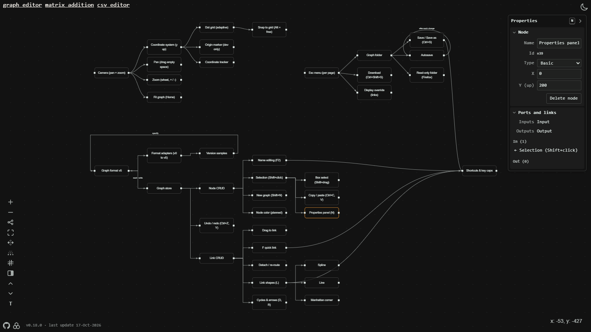

<h1 align="center">
    Project Imge
</h1>
<h3 align="center">
    Study project: Web based node editor / matrix calculators
</h3>
<p align="center">
    Live: <a href="https://kutaycoskuner.github.io/imge/">kutaycoskuner.github.io/imge</a>
</p>
<!-- <p align="center">
    <a href="#">Docs</a> |
    <a href="#">Report an Issue</a> 
</p> -->

<p align="center">
    
    
    
    
    
</p>

<p align="center">
    
    <br>
    <sub><i>v0.18.0 graph editor: the feature map, with the selected node in the Properties panel (N)</i></sub>
</p>

# Installation and Use

### Prerequisites

- **Node.js 18+**: [Install Node.js](https://nodejs.org/en/download/package-manager)

### Install and run

```bash
# 1. Clone the repository and go into it
git clone https://github.com/kutaycoskuner/imge.git
cd imge

# 2. Install packages
npm install

# 3. Start the development server: http://localhost:5173 opens the graph editor,
#    matrix addition is at /matrix_addition, csv editor at /csv_editor
npm run dev

# optional: run the unit tests
npm run test:unit -- --run
```

# Docs

- [Graph editor canvas](docs/graph-editor-canvas.md): current feature set, camera, coordinate system, zoom, dot grid
- [Node and link editing](docs/graph-editing.md): mouse and keys, selection, copy / paste, undo / redo, link rules, link shapes, function reference for the graph store
- [Graph file format](docs/graph-format.md): JSON structure, format versions, adapters that upgrade older files
- [Saving graphs and the Esc menu](docs/graph-saving.md): folder access, what is stored where, autosave, adding a menu to a page
- [Properties panel](docs/graph-properties-panel.md): the docked panel for the selection, what it shows, how to add a section (e.g. for a node type)
- [Graph types](docs/graph-types.md): kinds of graphs imge could draw, which are possible today and what each still needs

The live site counts visits with a self-hosted analytics script (archrium); local runs (`npm run dev`, preview) are not counted.


# Features

- [x] basic ui buttons
- [x] assistance message
- [x] settings interface
- [x] color mode
- [x] endless 2d canvas: one camera for pan and zoom, nodes / dots / coordinates always in sync
- [x] pan by dragging empty space, follows the mouse at any zoom
- [x] zoom toward cursor (mouse wheel) and screen center (buttons)
- [x] fit graph: the whole graph is shown on load, and with the toolbar's fit button
- [x] faint dot grid that follows the canvas (spacing doubles when zoomed out), on / off with a toolbar button
- [x] node dragging snaps to half grid squares (Alt = free move), on / off with a toolbar button
- [x] version and last update (build date) in the bottom-left bar; the version comes from package.json
- [x] origin marker (dev only): red / green L at (0, 0) toward +x / +y (Blender axis colors)
- [x] coordinates tracker (world coordinates, x right, y up)
- [x] node rendering
- [x] rendering from json content
- [x] node movement (multi-select with Shift+click or a Shift+drag box moves together)
- [x] add / delete nodes (toolbar button or Shift+A, Delete)
- [x] copy / paste nodes with the links between them (Ctrl+C, Ctrl+V at the mouse)
- [x] undo / redo (Ctrl+Z, Ctrl+Y / Ctrl+Shift+Z; a whole drag is one step)
- [x] Properties panel docked on the right (N or toolbar, hideable, like Blender's sidebar): shows and edits the selected node, nodes or link (name, position, links, shape, arrow, route, corner) so nodes on the canvas stay minimal
- [x] new empty graph (Shift+N or the Esc menu; asks first if there are unsaved changes)
- [x] node name editing (double-click or F2)
- [x] link rendering
- [x] node linking (drag output to input, or F on two selected nodes; drag an input's end away to detach); many links per port, each link with its own id
- [x] link shapes: spline, straight line or manhattan (right angles, draggable corner); L changes the selected link, the Esc menu can show all links in one shape or apply one shape to all
- [x] arrows per link: forward, backward, both or none (D), optional mid-link chevrons; link names shown in the middle of the link (double-click or F2)
- [x] cycles (1 -> 2 -> 1) and self-loops: the link closing a cycle goes around its nodes, above or below (R), lane draggable
- [x] direction: left-to-right or top-to-bottom; Transpose (toolbar button or Esc menu) switches it, ports, links and routes follow; switching back restores the layout
- [x] export data as json (default name imgegraph-<date>-<NN>.json)
- [x] point the editor at a folder on your computer: its imge graphs are listed by name and open with a click; Chrome / Edge save into the folder (optional remember folder, autosave), Firefox / Safari read it and save by download
- [x] Esc menu per page; the graph editor's has tabs Config / Examples / Keybindings (switch at the top right)
- [x] versioned graph format (now v5), older files upgraded on load; a sample per version in static/data/samples
- [x] example graphs in the Esc menu (mind map, flowchart, search tree, lattice, architecture map, release process, UML-ish), one per kind of graph in [docs/graph-types.md](docs/graph-types.md)
- [ ] node colors (stored in the file since v3, not drawn yet)
- [ ] vertical / horizontal frameworks
- [ ] node content editing
- [ ] add / remove ports

Shortcuts (Shift+N, Shift+A, Ctrl+C, Ctrl+V, Ctrl+Z, Ctrl+Y, N, F2, F, L, D, R, Delete, +/-, Home, Ctrl+S, Ctrl+Shift+S, Esc) and link rules: [docs/graph-editing.md](docs/graph-editing.md#mouse-and-keys); the toolbar hints and menu buttons show their keys as key caps
