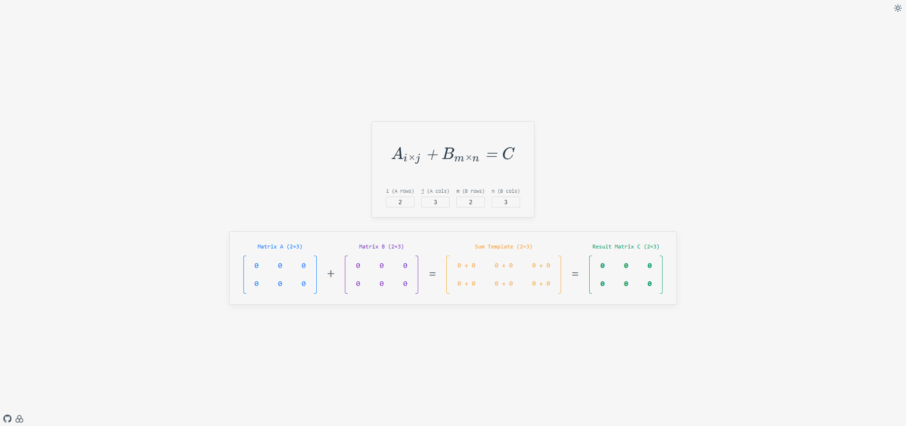

<h1 align="center">
    Project Imge
</h1>
<h3 align="center">
    Study project: Web based node editor / matrix calculators
</h3>
<!-- <p align="center">
    <a href="#">Docs</a> |
    <a href="#">Report an Issue</a> 
</p> -->

<p align="center">
    
    
    
    
    
</p>

<p align="center">


<figcaption>v0.22 Node and link display</figcaption>

</p>

# Installation and Use

### Prerequisites
- **Node.js 18+**: [Install Node.js](https://nodejs.org/en/download/package-manager)

### Install and run
```bash
# 1. Clone the repository and go into it
git clone https://github.com/kutaycoskuner/imge.git
cd imge

# 2. Install packages
npm install

# 3. Start the development server: http://localhost:5173 opens the graph editor,
#    matrix addition is at /matrix_addition, csv editor at /csv_editor
npm run dev

# optional: run the unit tests
npm run test:unit -- --run
```

# Features

### Features
- [x] basic ui buttons
- [x] assistance message
- [x] settings interface
- [x] color mode
- [x] endless 2d canvas: one camera for pan and zoom, nodes / dots / coordinates always in sync
- [x] pan by dragging empty space, follows the mouse at any zoom
- [x] zoom toward cursor (mouse wheel) and screen center (buttons)
- [x] fit graph: the whole graph is shown on load, and with the toolbar's fit button
- [x] faint dot grid that follows the canvas (spacing doubles when zoomed out)
- [x] origin marker (dev only): red / green L at (0, 0) toward +x / +y (Blender axis colors)
- [x] coordinates tracker (world coordinates, x right, y up)
- [x] node rendering
- [x] rendering from json content
- [x] node movement (multi-select with Shift+click moves together)
- [x] add / delete nodes (toolbar button or Shift+A, Delete)
- [x] node title editing (double-click or F2)
- [x] link rendering
- [x] node linking (drag output to input, or F on two selected nodes; drag an input's end away to detach)
- [x] export data as json
- [x] point the editor at a folder on your computer: its imge graphs are listed by name and open with a click; Chrome / Edge save into the folder (optional remember folder, autosave), Firefox / Safari read it and save by download
- [x] Esc menu per page (graph editor has its own)
- [x] versioned graph format, older files upgraded on load
- [ ] vertical / horizontal frameworks
- [ ] node content / color editing
- [ ] add / remove ports
- [ ] undo

Shortcuts (Shift+A, F2, F, Delete ...) and link rules: [docs/graph-editing.md](docs/graph-editing.md#mouse-and-keys)

# Docs
- [Graph editor canvas](docs/graph-editor-canvas.md): current feature set, camera, coordinate system, zoom, dot grid
- [Node and link editing](docs/graph-editing.md): mouse and keys, link rules, function reference for the graph store
- [Graph file format](docs/graph-format.md): JSON structure, format versions, adapters that upgrade older files
- [Saving graphs and the Esc menu](docs/graph-saving.md): folder access, what is stored where, autosave, adding a menu to a page

# Roadmap
- [ ] Accessibility buttons: Import / Export
- [x] Export data
- [x] Adding links on ui